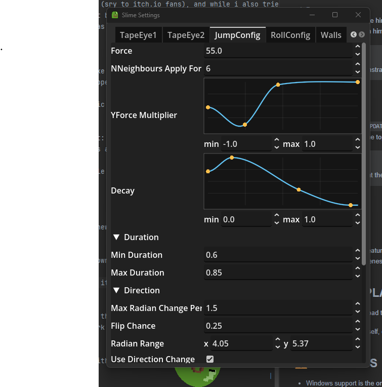

# Release 1: PetWOBBLE

(~~I don't have much time, but i will def add here image later,~~ thx for understanding <3 (*ˊᗜˋ*)/ᵗᑋᵃᐢᵏ ᵞᵒᵘ*)

## 🏁 Intro
Have you ever dreamt of having a pet.
Not just any Pet..., A squishy, wobbly & cute PET!
Then you are right here. Wobble is YOUR 🫵 Pet.
Download him and watch him make your life better, in any possible way imaginable... (~not really still much in work and progress xd~)

## 💡 Features
> ***NOW:***
> 1. Jump (boing boing 🐸)
> 2. Idle (yes he needs also rest you monster ``( ｡ •`ᴖ´• ｡))``
> 3. Dragging (`smashing`work in progress lul)
> 4. ROLLING (like a Stone, ... a wobbly stone)
> 5. Self written Procedual Soft Body with Texture support
> 6. ***YOUR*** Pet means ***YOURS***: You can open wobble up and configure him to your likings Σ(っ °Д °;)っ
> → Import your own sprites\
> → Configure the physics, lists and behaviors

> ***FUTURE:***
> 1. Speech Bubble, Shop?!,
> 2. ~~Smashing him into a wall and~~ see him SUFFER 🔥, 
> 3. AI (maybe someday if i somehow get veeery good at it lul),
> 4. and `reactive reactions/emotes`

## 😭 Hardships
I tried coding in c# (sry to itch.io fans), and while i also tried to use this new tool called **LimboAI** in godot, it was so :dolphin_noises:*** hard to make it work. I hope to learn much more by challenging myself on a fun project :)), (so wish me good luck fellas 🥲)
Also the physics soft body I tried to write has maken it really difficult with extreme challenges on how to morph the slime body (thats the hole reason why hes a slime), without breaking the physics\
PS. Self Collision has broken my soul xb

## 🎮 Controls
1. Drag to move 
2. Mouse Pusher → Poke him to watch him `Jiggleligle`
3. Right Click → To open him up and configure him ⚙️
> [!Note] 
> Due to current logic constraints, dragging only gets registered at its Points (outer line)

## ⚙️ Config
The data is stored at: `%APPDATA%\Godot\app_userdata\`\
Don't miss the arrows at the top right of the config screen. Cuz there is moooore to configure just a press away ;b
> [!Tip]
> Try the Debug toggle (at the bottom) they are really fun (ex. Drag View)

    

### Fun configs to try
After playing with the values, ... a lot..., i found these to be quite fun and interesting :))

| Setting | Value / action | What it does |
|---|---|---|
| Bend strength | `2.6` to `3` | Makes the slime shiver |
| Bend strength | `4` | Makes the slime break (like break break :o)|
| Area pressure | `0` | Makes the slime falter |
| Air drag + gravity | High air drag, very strong gravity | Makes it dive down wobbling like slime arrow |
| Damping | Large value | Creates a slow motion, stretchy slime effect |
| Freeze | Move over small objects | Can make the slime consume them like a slime (Effect achieved by dragging (Freezes Points from being simulated) |

## 📔 STORY
Wobble isn't just a new creature from another dimension. He is a old creature risen to life from my old EvolutionSimulator where they clashed to get the beset genes ever, i just love him so much i had to resurrect him, and make him SUFFER more 👹

## ▶️ HOW TO PLAY
Go to releases and download the latest, then you can run the exe when you have exported ALL files in the zip. Have fun :))

If you want to build it yourself, donwload the latest limboai godot build which supports dotnet :))

## ⚠️ WARNINGS
- Windows support is the only thing that works currently, as to make it transparent window i have to call native WinDll's
- ITCH.io doesn't work when coding godot.c#, that's why i cant publish it there
- The config logic is written by claude and copy pasted, as i wanted others to have the same fun playing with the configs easily and myself to use my time efficiently implementing the physics and behaviorl logic. Thank you for understanding :))

> [!TIP]
> HAVE fun playing with our fella :))

